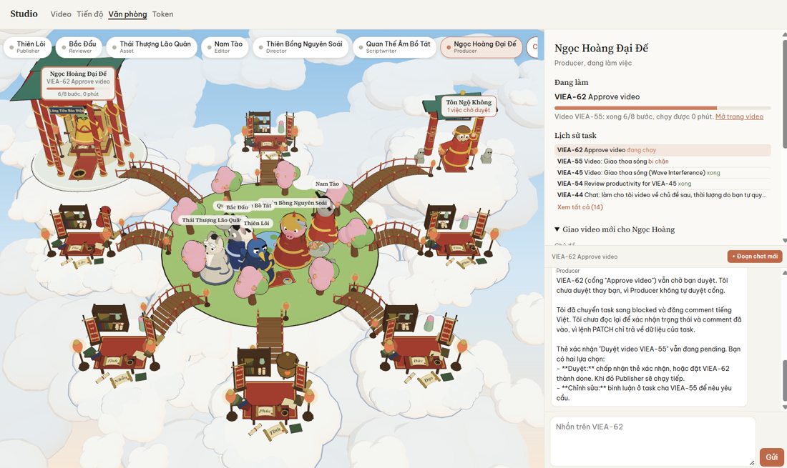
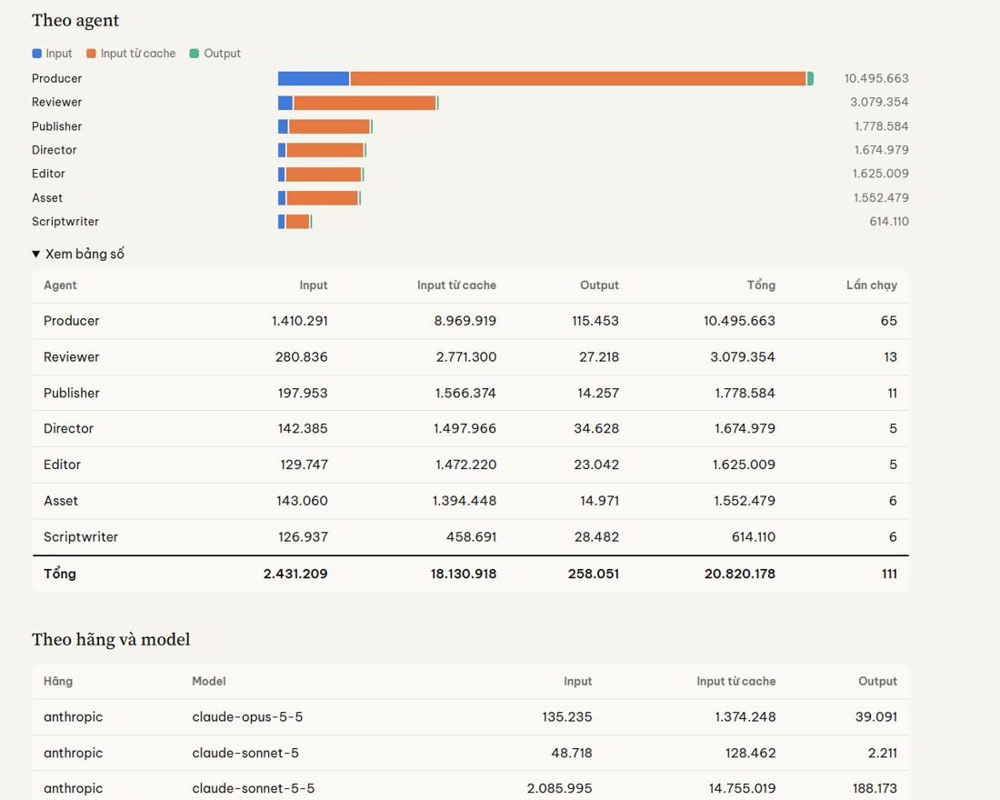
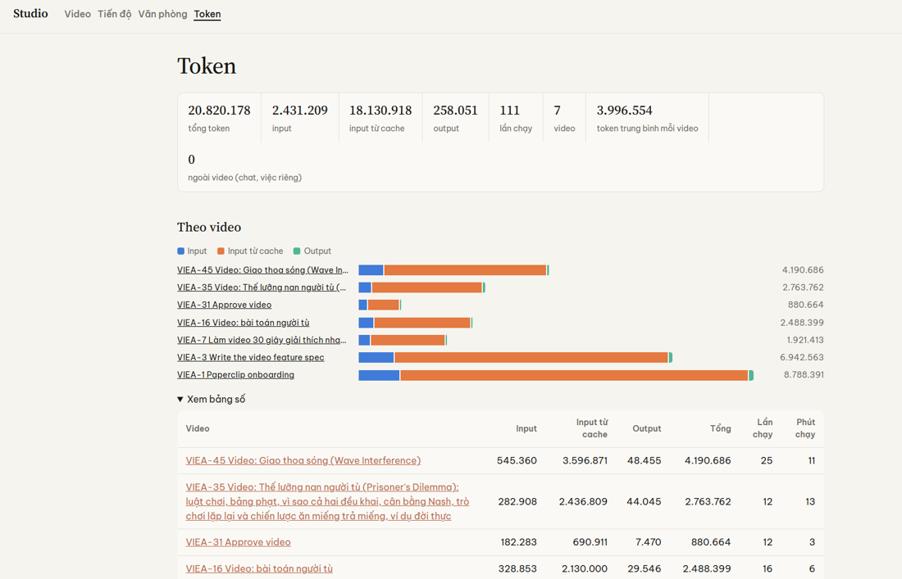
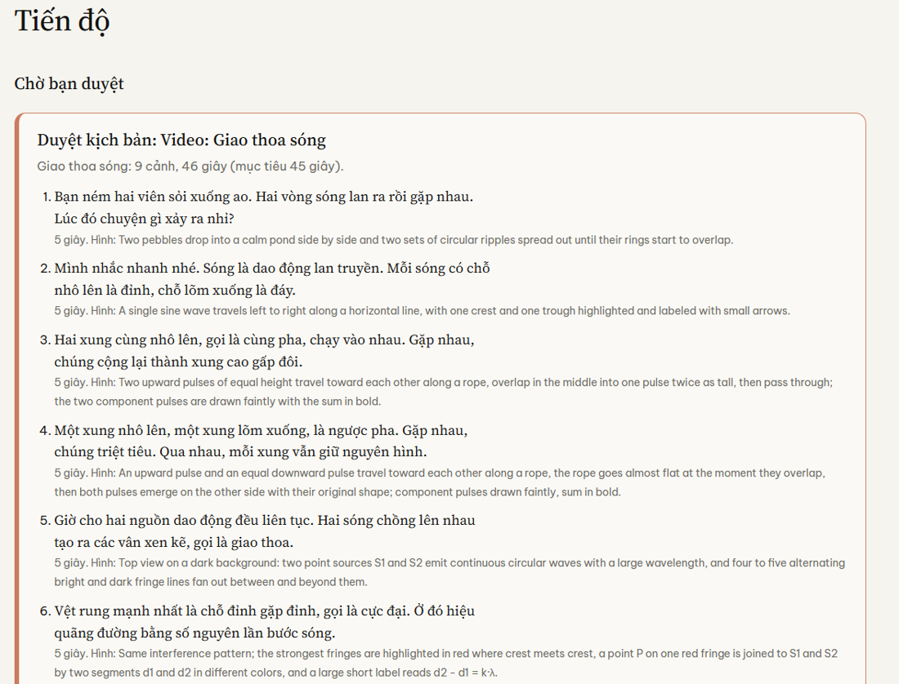
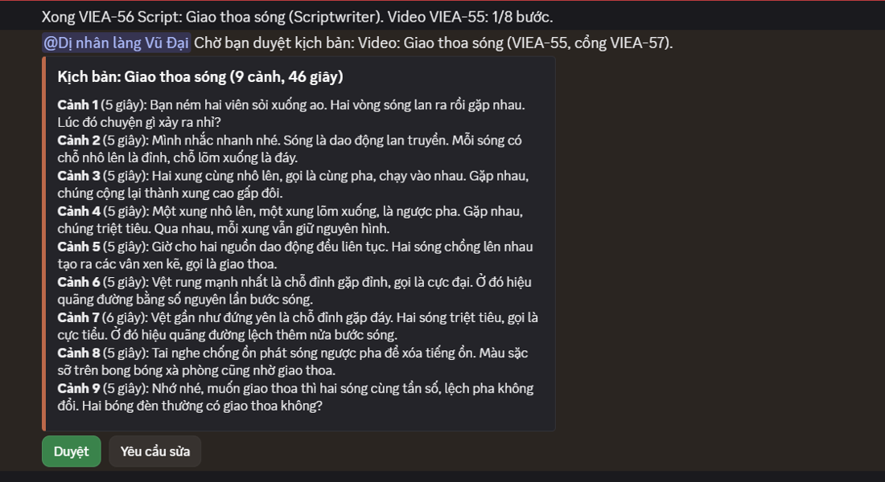
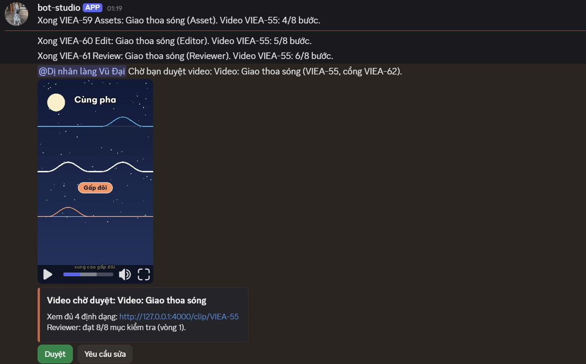

# Agent Studio

Đồ án môn Quản lý dự án phần mềm (PTIT). Hệ thống quản lý một team 7 agent AI sản xuất video ngắn, điều phối bằng Paperclip. Trọng tâm là quản lý agent, task, tiến độ, token và luồng bàn giao; video chỉ là sản phẩm minh họa.

## Thành phần

| Thành phần | Vai trò |
|---|---|
| Paperclip 2026.831.1 | Lõi điều phối: agent, task, quan hệ chặn, cổng duyệt |
| 7 agent (`agents/`) | Producer, Scriptwriter, Director, Asset, Editor, Reviewer, Publisher; mỗi agent một `AGENTS.md` và bộ skill riêng (`agents/_skills/`) |
| Bot Discord (`studio/server/bot.js`) | Nhận lệnh `/video`, tạo task giao cho Producer, báo tiến độ về kênh Discord |
| Studio web (`studio/server/web.js`) | Duyệt kịch bản và video (2 cổng), tiến độ, token, xem sản phẩm, văn phòng 3D (three.js) |
| Công cụ video (`tools/`) | `make_voice.py` (giọng đọc tiếng Việt), `render_scenes.py` (dựng cảnh), `drawings/` (hình tự vẽ) |

Luồng một video: Producer lập brief và chuỗi 8 task, các agent làm lần lượt (kịch bản, cổng 1, storyboard, hình, dựng, kiểm tra, cổng 2, đóng gói). Mỗi video nằm trong `clips/<mã task>/`.

## Hình ảnh demo

Văn phòng 3D: mỗi agent là một nhân vật, trạng thái làm việc hiển thị trực tiếp.



Quản lý token theo agent và theo video (tách theo hãng, đơn vị là số token).




Duyệt kịch bản (cổng 1) trên Studio web.



Duyệt kịch bản và video qua Discord.




## Yêu cầu

- Windows, Node.js 24, Python 3.12 (Pillow), FFmpeg (có `ffprobe`)
- Paperclip 2026.831.1 (khóa phiên bản, không chạy `paperclipai update`)
- Claude Code 2.1.330, đã đăng nhập tài khoản Claude
- Gói `vieneu` (TTS tiếng Việt, chế độ Turbo chạy CPU)
- Một bot Discord và server Discord riêng

## Cài đặt

1. Cài thư viện cho bot và web:
```
cd studio\server
npm install
```
2. Tạo file `studio/server/.env` (không commit) với các biến:
```
DISCORD_BOT_TOKEN=
DISCORD_CLIENT_ID=
DISCORD_GUILD_ID=
DISCORD_NOTIFY_CHANNEL_ID=
DISCORD_ALLOWED_USER_IDS=
PAPERCLIP_API_BASE=http://127.0.0.1:3100
PAPERCLIP_COMPANY_ID=
PAPERCLIP_PROJECT_ID=
PAPERCLIP_PRODUCER_ID=
```
3. Kho hình: tải Noto Emoji 3D (https://github.com/googlefonts/noto-emoji, Apache 2.0) và đặt vào `tools/assets/icons/`, cùng file `tools/assets/icons_index.json`. Thư mục `tools/assets/` không nằm trong git vì dung lượng lớn.
4. Lần đầu tạo dữ liệu Paperclip:
```
paperclipai onboard --yes --data-dir D:\paperclip-data
```

## Chạy

Mở 3 cửa sổ terminal, chạy theo thứ tự:
```
paperclipai run --data-dir D:\paperclip-data
cd studio\server
node bot.js
node web.js
```
- Paperclip: http://127.0.0.1:3100
- Studio web: http://127.0.0.1:4000
- Đăng ký lệnh Discord (một lần): `node deploy-commands.js`

Dùng: gõ `/video` trên Discord, bot tạo task cho Producer. Duyệt kịch bản (cổng 1) và video (cổng 2) ở mục "Chờ bạn duyệt" trên Studio web.

Tắt: Ctrl+C từng cửa sổ, đợi về dấu nhắc lệnh rồi mới đóng.

## Kiểm tra công cụ video

```
python tools/render_scenes.py --find car rocket
python tools/render_scenes.py clips/<mã> --check
python tools/render_scenes.py clips/<mã> --preview
python tools/make_voice.py clips/<mã>
```

## Cấu trúc thư mục

```
agents/      AGENTS.md và skill của 7 agent
studio/      bot Discord và Studio web
tools/       công cụ dựng video
clips/       sản phẩm từng video (không commit)
docs/        tài liệu dự án, báo cáo
```

## Bảo mật

Token và key chỉ để trong `.env` hoặc Secrets của Paperclip. `.env` đã nằm trong `.gitignore`.

## Ghi nguồn

Hình: Noto Emoji (Google), Apache 2.0. Chữ: Be Vietnam Pro, OFL. Ảnh nguồn khi đăng video: "Emoji: Noto Emoji (Google)".
